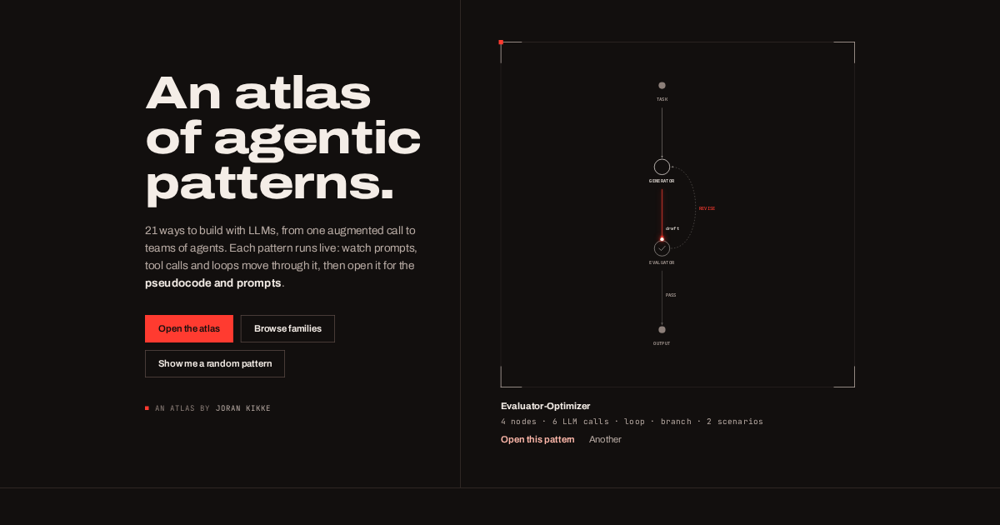

# Agentic Atlas

A visual field guide to agentic AI patterns. It covers 21 ways to build with LLMs, from a single augmented call to teams of agents, grouped into 6 families. Each pattern has:

- a **live diagram** that plays a scripted run, with prompts, tool calls, loops and branches moving through it;
- **hover explanations** for every node and edge, and an example payload on each edge;
- **pseudocode and prompt templates**, synced to the step the diagram is on;
- notes on when to use it, what it is often confused with, and sources.

**Live site:** https://dangerousbeans.github.io/agentic-atlas/

[](https://dangerousbeans.github.io/agentic-atlas/)

The diagrams play scripted traces that show control flow. They are not live model runs.

## Running it

Requires Node 24.

```bash
npm ci
npm run dev                 # dev server on http://localhost:4321
npm test                    # unit tests (Vitest)
npm run check               # type check (astro check)
npm run build               # static site in dist/
npx playwright test         # end-to-end, accessibility (axe), screenshot sweep, runtime perf
npm run budget              # JS budget: <= 15 KB gzip per page (needs a build)
npm run perf                # Lighthouse CI, mobile, against dist (needs a build)
                            # LCP is ~2.1s against the 2.5s cap in lighthouserc.json; the LCP element is the display-font h1
```

`npx playwright install chromium` is needed once before the Playwright tests. Set `PW_PORT` to run Playwright's server on another port, and `PW_SKIP_BUILD=1` to serve the existing `dist/` instead of rebuilding. With `CI` set, the runtime perf specs use looser limits; they run in their own `perf` project, after the rest, on one worker. Screenshots land in `test-results/screens/`.

To build for a sub-path (as GitHub Pages does), set `BASE_PATH`, for example `BASE_PATH=/agentic-atlas npm run build`.

## Project structure

```
src/
  content/
    families/*.yaml          the 6 families: name, rank, description, pattern order
    patterns/<slug>/
      pattern.yaml           metadata, diagram, scenarios, pseudocode, prompts
      index.mdx              the prose write-up
  lib/
    schema.ts                Zod schemas and cross-checks for all content
    catalog.ts               loads and orders families and patterns
    pattern-stats.ts         stats computed from a diagram (LLM calls, loops, ...)
    diagram/                 the diagram engine: ELK layout, compile, frame state
  components/
    diagram/                 Diagram.astro (SVG at build time) and flow-player.ts (playback, tooltips)
    atlas/                   the pannable 2D atlas map
    home/, pattern/, site/   page sections and site chrome
  pages/                     /, /atlas/, /families/, /patterns/<slug>/, /about/, 404
scripts/
  check-budget.mjs           per-page JS budget gate
  og.mjs                     renders public/og.png from the home page
  serve-dist.mjs             tiny static server for dist/
tests/
  unit/                      Vitest
  e2e/                       Playwright
```

The site is static (Astro). Diagrams are laid out and rendered to SVG at build time, so every page reads without JavaScript; a small custom element animates them in the browser.

## Adding a pattern

1. Create `src/content/patterns/<slug>/pattern.yaml` and `index.mdx`.
2. Add the slug to its family's `order` list in `src/content/families/<family>.yaml`.
3. Run `npm test`. The content tests validate the YAML and report any broken reference.

`pattern.yaml`, in brief:

```yaml
slug: my-pattern                  # must match the folder name
name: My Pattern
family: workflows                 # a family slug
aliases: [Other name]
summary: "One sentence, 10 to 160 characters."
badges: { autonomy: low, cost: medium, latency: high }   # low | medium | high
sources:
  - { title: Paper or guide, url: https://example.com }
related:
  composesWith: [guardrails]
  confusedWith:
    - { slug: routing, difference: "How the two differ, in one sentence." }
code:                             # pseudocode blocks (python | markdown | text)
  - { id: main, title: pattern.py, lang: python, source: "..." }
prompts:
  - { id: system, title: System prompt, lang: markdown, source: "..." }
diagram:
  direction: RIGHT                # or DOWN
  nodes:                          # kinds: io, llm, tool, router, evaluator, aggregator, memory, human, guard, agent
    - { id: task, kind: io, label: Task, description: "What this node is, in a sentence." }
    - { id: model, kind: llm, label: LLM, description: "What the model does here." }
  edges:                          # style: solid | dashed | loop
    - { id: ask, from: task, to: model, label: prompt, description: "What travels on this edge.", example: "A sample payload" }
  scenarios:
    - id: happy
      label: Happy path
      steps:
        - id: s1
          caption: What happens in this step.
          events:                 # send | activate | branch | appear | read | write
            - { type: send, edge: ask, token: { kind: prompt, label: task } }
            - { type: activate, node: model, status: thinking }
          codeRef: { block: main, lines: "1-3" }   # optional: highlight pseudocode lines
```

Every node needs a `description`, and every edge needs a `description` and an `example`; the schema requires them, so a pattern without them fails the build and `npm test`. Quote any value that contains ` #`, because YAML treats the rest of the line as a comment. The full schema is in `src/lib/schema.ts`.

## Credits

Made by [Joran Kikke](https://github.com/dangerousbeans).

Built with Astro, ELK, Expressive Code and Pagefind. Typeset in Archivo and JetBrains Mono.

## Licence

- **Code** is MIT licensed. See [LICENSE](LICENSE).
- **Content**, meaning the pattern write-ups, diagrams and prompts in `src/content/` plus everything in `docs/`, is licensed under [CC BY 4.0](LICENSE-content). Please attribute it as "Joran Kikke, Agentic Atlas".
